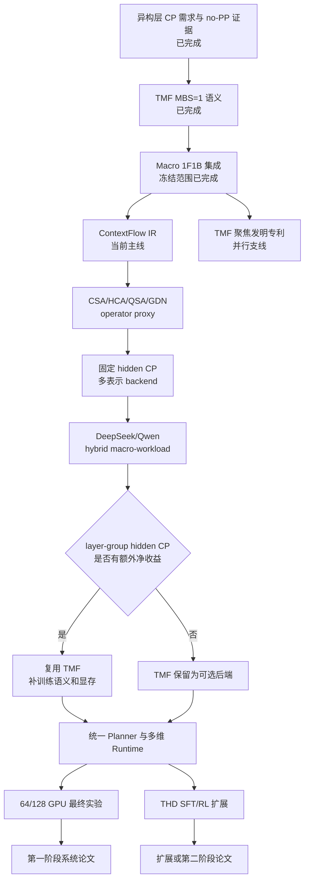

# Heterogeneous Context Parallelism + TMF 系统总 Roadmap

> 创建：2026-09-01  
> 更新：2026-09-03  
> 文档职责：描述项目的完整研究目标、核心 idea、长期系统路线、顶会实验闭环、知识产权支线和当前完成状态。  
> 当前短期执行入口：本文第 11–13 节；旧的 lane/cohort 粒度计划保留为已完成的历史实验计划，不再是主线入口。  
> 可靠证据入口：`progress/TMF_RELIABLE_CONCLUSIONS_AND_AGENT_RUN_EVIDENCE_20260901.md`。  
> 本文是独立的总 roadmap，不替代已有的阶段性 1F1B roadmap 和 agent 执行计划。

## 1. 项目目标与当前结论

项目目标是构建一个面向长序列预训练、SFT 和 RL 后训练的 heterogeneous context parallelism（HCP）系统。系统不再把 CP 抽象为“每层一个 CP degree”，而是把 dense/compressed/sparse/recurrent 等 token mixer 编译为统一的上下文数据流，并针对 token、compressed KV、index、recurrent state 等不同表示分别选择切分、复制、路由、通信和调度方式；只有当 hidden-state 的 DP/CP 分解确实需要改变时，才调用 TMF 完成时序合法化。

当前可以使用的结论是：

> heterogeneous CP 的机制可行性和方向性收益已经得到可靠验证；TMF 已经解决 MBS=1 时缺少 batch 自由度、无法直接改变 DP/CP 分解的核心语义问题。no-PP 场景已经完成 transition、temporal bundle、正确性和长序列方向性收益验证；macro-cohort TMF 已在 PP=2 完成校准正确性和长序列性能闭环。但是，cohort/lane 粒度扫描没有产生决定性提升，128K 的 CP1 路径在 Triton transition kernel 下仍然 OOM，且当前可重复的明显收益主要集中在 GDN CP1。由此，项目主线从“继续微调 1F1B TMF”转为“先建立多表示 ContextFlow IR 和算子专用 CP backend，再由证据决定是否改变 hidden-state CP degree”。

这不是“真实训练系统已经完成”的结论。当前尚未完成 CSA/HCA/QSA 算子 backend、多表示 layout、动态 sparse payload 通信、多节点、真实 optimizer 多步轨迹、checkpoint/recompute、训练恢复、完整 TP/DP/PP/CP/EP 组合、THD 动态规划以及 64/128 GPU 最终实验；128K CP1 还存在稳定 OOM，可行域没有闭合。

### 1.1 2026-09-03 战略更新摘要

1. **HCP 的统一对象升级为上下文数据流。** layer type 只用于前端识别；系统内部以 `Compress`、`GlobalIndex`、`SparsePayload`、`Window` 和 `PrefixState` 等依赖原语描述执行语义。
2. **默认保持 canonical hidden layout。** 优先在同一 token CP 上改变 compressed KV、index 和 state 的布局与通信算法，避免逐层 remesh。
3. **TMF 降为有条件的 mesh-transition backend。** 只有 layer-group 级低 CP 收益能够覆盖 transition、等待、显存和调度成本时，才改变 hidden-state 的 DP/CP 分解。
4. **DeepSeek-V4 与 Qwen3.8-Flash-Next 成为首批结构忠实 workload。** 前者覆盖 CSA/HCA 的交替 compressed-attention，后者覆盖 `3×GDN + 1×QSA` 的 recurrent/sparse macro-group。
5. **快速知识产权支线与顶会主线分离。** 近期发明专利只围绕已有代码支持的“MBS=1 optimizer-step-preserving TMF + 可逆 CP layout transition”，不把尚未实现的统一 IR、自动 planner、FSDP runtime 或 QSA backend写入核心保护链。

### 1.2 2026-09-02 profiling 决策摘要

证据来源：

- `agent_run/20260901T133800Z_a7c4d09_tmf_g3_remote_macro/`：32K/64K、
  `M=8/16/32/64` 共 120 个正式 launch，另有 128K 探针；
- `agent_run/20260902T080428Z_a7c4d09_tmf_0831_perfopt_g4/`：32K、M=64
  的 45 个消融 launch 和 7 组 Nsys。

当前可用于路线决策的观测为：

| 观测 | 数据 | 路线含义 |
| --- | --- | --- |
| CP1 完整配置收益 | 6104.093→5024.459 ms，time −17.69%，1.215× | 继续把 CP1 作为主要收益 layout，但必须同时解决 128K 显存边界 |
| CP2 完整配置收益 | 6104.093→5839.366 ms，time −4.34%，1.045× | CP2 是较小收益/较宽可行域候选，不应宣称无效，也不应与 CP1 做纯 Adapter 归因 |
| Triton layout 融合 | CP1 −0.02%，CP2 +0.04% | correctness/工程价值成立，但局部 pack/assemble kernel 不再是性能优先级 |
| 前向逐 lane overlap | CP1 −0.25%，CP2 −0.35% | 真实 overlap 已发生，但收益受通信碎片和资源竞争限制 |
| NCCL 数量 | static 4545/rank；CP1 约 1873–1921；CP2 约 3297–3329 | CP1 的主收益与减少 GDN/Ulysses SendRecv 一致；细粒度 overlap 自身会增加提交/内核碎片 |
| consumer tail | CP1 D 单 range max 0.947 ms；CP2 D max 0.416 ms | 前向最后 tail 已不是足以单独解释整体差距的大瓶颈，out-proj 再切 chunk 降为条件项 |
| backward 主阶段 | max-rank `cohort_backward` 约占 CP1 D 3.35/5.04 s、CP2 D 4.10/5.88 s | 下一主要代码研究应转向精确 backward critical path 和 inverse transition overlap |
| macro/stage tail 与 cohort 粒度 | 后续粒度实验未产生决定性提升 | 冻结 macro 作为 oracle；不继续以 streaming/lane 微调作为主线 |
| 128K 可行域 | CP1 稳定 OOM；static CP4 和 CP2 PASS | checkpoint、graph/buffer lifetime 和 layout memory contract 纳入 G5/G6；CP1 只保留为可行域上界 |

上述 component 数值来自 CUDA event/host range，部分 backward hook 为 inclusive；
它们用于排序下一步诊断，不作为可相加的 step-time 分解。

## 2. 状态标记

| 标记 | 含义 |
| --- | --- |
| **已完成** | 已有代码、原始运行和冻结门禁支持，可以作为下一阶段基础 |
| **部分完成** | 核心机制或原型已存在，但验证范围不足以形成最终系统结论 |
| **进行中** | 当前阶段的主要代码或实验工作 |
| **未开始** | 只有设计目标，尚无可用实现或实验闭环 |
| **条件项** | 是否继续取决于前一阶段的同口径性能证据，不预设一定需要 |

任何阶段只要出现正确性、显存、通信、流水线或稳定性瓶颈，就进入该阶段的诊断与优化分支；问题未被解释和解决前，不把后续功能堆叠在不稳定基础上。

## 3. 核心问题：为什么需要 heterogeneous CP

长序列训练通常给所有层配置相同的 CP degree，但不同类型的层对 CP 的需求并不相同：

- Attention 的显存和计算随序列长度快速增长，需要较高 CP 才能放入显存；ring attention 的通信还可能被 Attention 计算部分掩盖。
- GDN、线性注意力、SSM 或其他序列模块的显存和计算结构不同。GDN 的 Ulysses 风格 all-to-all 通信不能假设被完全掩盖，高 CP 可能只增加通信和 kernel 碎片，而没有提供与 Attention 相同的收益。
- 当总 GPU 数固定时，`DP × CP` 通常受同一 mesh 约束。降低某一层的 CP 会相应增加该层的有效 DP，因此 heterogeneous CP 同时改变计算分摊、CP 通信和数据并行复制方式。

原始问题可以表述为：在给定模型、序列、GPU 和显存约束下，不再为整个模型选择一个统一 CP，而是为每个层或 layer segment 选择合适的 CP：

\[
CP_l \in \mathcal{C},\qquad DP_l = \frac{W_{DP\times CP}}{CP_l}.
\]

这是统一 ContextFlow 问题中的一个特例。最终目标不是证明“CP 越小越快”，而是同时选择上下文表示、通信 backend 和必要时的 hidden-state CP。Attention 可能需要 CP8，某些 GDN 层可能适合 CP1、CP2 或 CP4；只有低 CP 节省的计算/通信能够覆盖 transition、PP bubble 和额外 activation memory，才执行 TMF remesh。

### 3.1 新一代 hybrid model 对问题定义的扩展

DeepSeek-V4 和 Qwen3.8-Flash-Next 表明，未来 hybrid model 的异构性不再只是 full attention 与 GDN 的差异：

| 算子 | 上下文表示 | 依赖与通信特征 | 第一候选 backend |
| --- | --- | --- | --- |
| HCA | 每 128 个 token 形成一个 compressed KV entry | 在压缩序列上做全局 dense attention，通信规则且 payload 小 | boundary halo/local compress + compressed all-gather |
| CSA | 每 4 个 token 形成 compressed KV，再选择 Top-k compressed entries | 全局压缩索引，核心 payload 仍是 compressed KV | boundary halo/local compress + compressed all-gather + local select |
| QSA | 4-token micro-block index，选中 block 后访问原始 token KV | 全局 index 与动态、数据相关的原始 KV payload 分离 | replicated/sharded index + sparse ring 或 owner-routed KV |
| GDN | 固定大小 recurrent state | prefix/state 顺序依赖，通信量和计算缩放不同于 attention | state propagation/scan、headwise CP，或有条件的低 CP + TMF |

严格来说，HCA 不是对压缩 KV 再做稀疏选择，而是对高度压缩后的序列做 dense attention。DeepSeek-V4 的训练实现已经采用“两阶段 contextual parallelism”：相邻 rank 交换压缩窗口边界 token，在本地压缩后 all-gather compressed KV，再执行 fused select-and-pad。这说明统一系统首先应支持“同一 hidden CP、不同内部表示布局”，而不是直接为 CSA/HCA 逐层切换 hidden CP。

来源：

- [DeepSeek-V4 Technical Report](https://arxiv.org/html/2606.19348v1)；
- [Qwen3.8-Next Technical Report](https://arxiv.org/html/2608.30320v1)；
- [Qwen3.8-Flash-Next 官方仓库](https://github.com/QwenLM/Qwen3.8-Flash-Next)。

### 3.2 ContextFlow IR：统一 HCP 抽象

每个 token mixer 应展开为一张 representation/data-dependency graph，而不是注册一个模型品牌或硬编码 layer type。首版 IR 只需要以下五类原语：

```text
Compress(rate, overlap, segment_aware)
GlobalIndex(granularity, topk, dynamic)
SparsePayload(source=compressed|original_token)
Window(radius)
PrefixState(state_shape, transition)
```

每个 IR value 必须携带：

- logical sample、packed-sequence segment 和 token position；
- 表示类型：token、compressed KV、index、sparse metadata 或 recurrent state；
- 输入/输出 sharding、replication 和 owner mapping；
- forward/backward dependency、saved tensor、recompute 与 auxiliary loss；
- 通信规则性、消息大小、拓扑和可 overlap 区间。

HCP plan 不再是单个 `CP_l`，而是：

\[
P_l=(L_l^{in/out},\{L_l^r\},A_l,G_l,S_l),
\]

其中 `L^{in/out}` 是 hidden-state layout，`L^r` 是各类中间表示 layout，`A` 是通信算法，`G` 是 block/chunk/cohort 粒度，`S` 是执行调度。

### 3.3 HCP 的三级执行策略

1. **算子/表示异构，hidden layout 不变。** 同一 `C_x` 下为 compressed KV、index 和 state 选择不同布局。该级别不需要 TMF，是 DeepSeek-V4 的默认候选。
2. **layer-group hidden mesh 异构。** 只有相邻多层共享显著不同的最优 `C_x` 时才执行 remesh。Qwen 的 `3×GDN + 1×QSA` 是首个候选 macro-group；逐层交替的 CSA/HCA 默认不切 hidden CP。
3. **时序合法化。** 当 spatial microbatch slots 不足以支持目标 DP/CP 分解时，以 TMF 从同一 optimizer step 内的独立 logical microbatches 构造 temporal cohort。

该分层把 TMF 从“所有异构层都必须经过的路径”改为“只有第 2 级触发且空间不可整分时使用的执行后端”，避免把已有原型的通信和 activation lifetime 成本施加到所有 hybrid model 上。

## 4. MBS=1 的结构性障碍

真实大模型训练常使用 `microbatch_size=1`。如果相邻 layer 的 CP 从 `CP_a` 变为 `CP_b`，对应的有效 DP 也会变化。空间上的一个 logical microbatch 只有一条样本，不能直接拆成多个彼此独立的数据并行样本：

\[
MBS=1 \quad\Longrightarrow\quad \text{不存在足够的 batch slots 完成 }DP_a\leftrightarrow DP_b.
\]

简单复制同一条样本虽然能满足 tensor shape，却改变了 unique sample throughput 和训练语义；单纯增大用户可见 MBS 又可能超过激活显存。因此，heterogeneous CP 在 MBS=1 下缺少的不是一个 reshape kernel，而是能够保存多条独立 logical samples、同时不改变 optimizer batch 语义的额外自由度。

## 5. TMF：从时间维获得可转换的并行自由度

Temporal Mesh Folding 从连续到达的 `K` 个 logical microbatches 中获得时间维自由度，将它们组成一个 cohort：

\[
\mathcal{B}_q=\{b_{qK},b_{qK+1},\ldots,b_{qK+K-1}\}.
\]

在需要降低 CP、提高有效 DP 的 layer segment 前，Adapter 将 cohort 中的独立 logical samples 按目标 temporal width 聚合，完成 CP remesh；离开该 segment 后再 split，恢复每条 logical microbatch 的 identity 和原始边界。TMF 必须保持以下不变量：

1. **identity 不变量**：每条 logical sample 在 forward、loss、backward 和 optimizer accounting 中只出现一次。
2. **顺序不变量**：pack/split 前后的 logical ID 顺序确定且可恢复。
3. **梯度不变量**：transition backward 将梯度返回到正确的 logical input，参数梯度只在该层所属的有效 DP group 中同步一次。
4. **batch 语义不变量**：TMF 不改变 global batch、gradient accumulation 或 unique token 计数。
5. **退化不变量**：固定 CP 或不需要 temporal folding 时 `K=1`，路径退化为普通执行。

TMF 与几个相似概念的区别如下：

| 机制 | physical execution | unique samples | 训练语义 |
| --- | --- | --- | --- |
| 增大用户 MBS | 同时计算更多样本 | 增加 | 激活显存和优化器 batch 语义可能改变 |
| Gradient accumulation | 多个独立 step 累积梯度 | 不变 | 不提供 layer 内 DP/CP remesh 所需的同时存在 payload |
| Repeat replication | 复制相同 logical sample | 不增加 | shape 可运行，但 unique throughput 按复制倍数下降 |
| TMF temporal bundle | 聚合不同 logical microbatches | 不变 | 提供 remesh 自由度并保持 logical batch 语义 |

### 5.1 Macro-cohort TMF

当前实现把一个 cohort 作为 1F1B scheduling unit。stage 内由 Adapter 完成 pack、CP transition、低 CP block 和 split，PP 边界仍传输 cohort 中各个 logical tensor。优点是状态简单、正确性边界清楚；代价是 pipeline units 从 `M` 减少为 `M/K`。

实际 bubble 取决于真实 `M/K`。当前短 profile 的 `M=8,K=4` 只有 2 个 pipeline units，放大了 bubble；真实百卡/千卡训练的 global batch 常更大，macro 路径可能已经足够。不能在没有真实大 `M` 对照前预设 streaming 一定更快。

### 5.2 Streaming TMF

Streaming 版本保持 logical microbatch 级 PP 流动，只在 stage 内 TMF boundary 暂停 payload。相同 cohort 的 slots 到齐后执行低 CP segment，随后逐条释放 continuation，使 PP scheduler 接近保留 `M` 个调度单元。

它需要显式状态机管理：

- logical microbatch 到 cohort/slot 的稳定映射；
- boundary enqueue、ready、release 和 resume；
- forward continuation 与 backward dependency；
- warmup、steady、cooldown 中的 outstanding cohorts；
- 多个 graph 的生命周期和 activation memory；
- deadlock-free P2P 与 collective ordering。

Streaming 是**条件项**：只有相同 DP/CP layout、真实 `M/K` 下 macro bubble 超过测量噪声并实质侵蚀 heterogeneous CP 收益时，才需要把它发展为默认生产路径。

## 6. 与 1F1B 和多维并行的统一

统一 runtime 需要覆盖以下组合，而不是为每种模型或配置维护独立代码路径：

| 维度 | 退化情况 | 一般情况 |
| --- | --- | --- |
| PP | `PP=1` 时没有跨 stage P2P | `PP>1` 使用 canonical 1F1B 或后续调度器 |
| CP | `CP=1` 时无 CP collective | `CP>1` 使用 ring、Ulysses 或对应序列并行 kernel |
| context representation | token hidden 使用单一 layout | token、compressed KV、index、state 分别具有 layout |
| sparse payload | 固定规则或全复制 | data-dependent block owner、sparse ring 或 routed KV |
| CP layout | 所有层相同 CP，不发生 transition | 不同 layer segment 使用不同 CP |
| TMF | fixed CP 时 `K=1` | mixed CP 时由 CP 比例决定 cohort width |
| stage width | 所有 stage 的 `K_stage` 相同 | 不同 stage 可有不同 `K_stage`，global K 负责对齐 |
| stage boundary | 相邻 stage 使用相同边界 layout | 后续支持跨 stage CP 和动态 wire layout |

完整多维并行还需要补齐：

- TP 与 CP group 的正交或嵌套关系；
- CSA/HCA/QSA/GDN 的 representation-specific group、metadata 和 backward；
- dynamic sparse index 的 worker/step load balance 与 owner skew；
- CP collective 与 MoE EP all-to-all 的链路/SM 竞争和 overlap；
- layer-specific DP group 中的参数梯度同步；
- distributed optimizer/ZeRO 的参数和 optimizer-state ownership；
- activation checkpoint 与 TMF graph lifetime；
- PP stage placement、virtual pipeline 和可能的 interleaved schedule；
- 跨节点 topology-aware CP/DP group placement；
- checkpoint save/resume 时 layout 与 optimizer state 的恢复。

## 7. 跨 stage CP

当前实现要求 PP stage 入口和出口回到统一的 width-1 logical wire layout，并禁止相邻 stage 边界使用不同 CP。这样保证 PP P2P 和 1F1B scheduler 不需要理解 stage 内 heterogeneous layout。

后续跨 stage CP 的价值是避免在 stage 尾部强制恢复高 CP，或允许 planner 将相同低 CP segment跨 stage 连续放置。实现需要定义：

1. boundary 上的 canonical logical identity 与 physical shard 描述；
2. 发送端和接收端不同 CP group 的 rank mapping；
3. 动态 wire tensor shape、metadata 和 buffer lifetime；
4. forward cohort formation 与 backward inverse mapping；
5. 不同 `K_stage` 之间的 boundary protocol；
6. PP P2P 与 CP collective 的全局顺序，避免循环等待。

跨 stage CP 也是**条件项**。只有 planner 或 profiling 表明“stage 边界强制恢复”在目标模型中频繁出现且代价显著时，才值得承担动态 wire protocol 的复杂度。

## 8. 性能模型与自动 Planner

最终 planner 的决策变量应至少包括：

\[
\pi=\{TP,PP,DP_l,C^x_l,\{L^r_l\},A_l,G_l,K,
\text{stage placement},\text{checkpoint},\text{TMF mode}\}.
\]

其中 `C^x_l` 是 hidden token 的 CP degree，`L^r_l` 是 compressed KV、index、sparse payload 和 state 等表示的布局，`A_l` 是算子 backend，`G_l` 是 block/chunk/layer-group 粒度。参数、梯度和优化器的 ownership mesh 默认保持固定，不因 activation context view 改变而改变。

优化目标是在显存、整除、拓扑和正确性约束下最小化端到端 step time：

\[
\pi^*=\arg\min_{\pi}T_{step}(\pi)
\quad\text{s.t.}\quad
M_{peak}(\pi)\le M_{GPU},\;\pi\in\mathcal F.
\]

`T_step` 不能只做各 layer latency 相加，而应包含：

\[
T_{step}=T_{compute}+T_{repr\_comm}+T_{sparse\_imbalance}
+T_{transition}+T_{PP}+T_{EP}+T_{DPsync}+T_{bubble}-T_{overlap}.
\]

模型至少需要以下 profile primitive：

- 每种 layer type 在不同 sequence、CP、TP、dtype、checkpoint 下的 forward/backward；
- 每个 ContextFlow primitive 在不同 compression ratio、Top-k、block size、state shape 和 payload owner 分布下的 forward/backward；
- ring attention 的暴露通信和 GDN/Ulysses all-to-all；
- compressed all-gather、sparse ring、owner-routed KV、state propagation/scan 和 boundary halo；
- 每种 CP transition 的 tensor volume、collective algorithm 和 topology；
- macro/streaming 的 pipeline schedule simulation；
- parameter gradient all-reduce/reduce-scatter；
- activation、transition graph、P2P buffer 和 optimizer state 显存；
- NVLink 域内、跨 NUMA、跨节点 IB 的分段带宽与延迟。

当前 `model_no_pp_cp.py` 和历史 profile 只用于实验筛选。最终 planner 应在 held-out 配置上报告预测误差、搜索时间和所选配置相对 exhaustive/manual oracle 的 gap；如果误差不能稳定区分候选 layout，就必须先扩展 profile 和模型，而不是继续增加 planner 规则。

## 9. THD、SFT 与 RL 的动态 CP

预训练阶段通常可以为固定 sequence 和 layer type 离线选择 `CP_l`。THD 格式的 SFT/RL 数据包含长度不同的单条序列，进一步把决策扩展为：

\[
CP_{i,l}=f(L_i,\text{layer}_l,\text{topology},\text{memory},\text{runtime state}),
\]

其中 `i` 是 logical sequence，`l` 是 layer。系统不再只做 layerwise heterogeneous CP，而是对每条序列的长度和每层计算特征联合选择 CP。

动态 THD runtime 需要解决：

1. **Padding-free identity**：保持 THD 中每条 sequence 的 cumulative lengths、position IDs、attention/loss mask 和 document boundary。
2. **Cohort formation**：按 CP plan signature、长度区间和到达时间组成 cohort，避免等待最慢或最长序列。
3. **负载均衡**：同一 rank 上不同 sequence 的 token 数和 layer cost 不同，需要估计真实 work 而不是只按样本数分配。
4. **计划缓存**：对常见长度 bucket 和 layer segment 缓存 layout，避免每 step 重新搜索和建立 process groups。
5. **重配置抖动**：使用 hysteresis 或收益阈值，只有预测收益覆盖 transition 和重配置成本时才切换 CP。
6. **RL 在线分布**：response length 随 policy 和 rollout 变化，planner 需要处理分布漂移、生成/训练资源耦合和多模型并存。

这部分可以成为第一篇系统论文的扩展能力，也可以形成后续独立工作。第一篇论文不应因为等待完整 RL runtime 而推迟 ContextFlow IR、representation-specific HCP backend、条件式 TMF 与 planner 的闭环。

## 10. 论文级贡献结构

面向 MLSys/SC 的第一阶段论文应形成以下贡献链：

1. **问题发现与量化**：证明 recurrent、compressed-dense、compressed-sparse 和 dynamic-sparse mixer 对 context representation 与通信算法的需求不同；单一 CP/layout/backend 会造成系统性浪费。
2. **ContextFlow IR**：把 token、compressed KV、index、sparse payload 和 recurrent state 的依赖、布局与 backward 统一表示，使新 hybrid architecture 不需要逐模型重写 distributed runtime。
3. **多表示 HCP runtime**：在 canonical hidden layout 上执行 representation-specific all-gather、halo、sparse ring/routing 和 state propagation，并处理 packed sequence、动态稀疏负载与 CP/EP 通信竞争。
4. **有条件的 TMF**：在 profiler 证明 layer-group hidden remesh 有净收益且 MBS=1 空间不可整分时，以 optimizer-step-preserving temporal folding 合法化 DP/CP 转换。
5. **联合 planner**：在显存约束下联合选择 representation layout、operator backend、hidden CP、layer group、TMF、PP/FSDP substrate 和 checkpoint。
6. **生产尺度证据**：在 DeepSeek-V4 风格 CSA/HCA 和 Qwen3.8 风格 GDN/QSA workload 上，相对每个 workload 的最佳手工配置获得可重复的端到端收益，并解释收益与适用边界。

已有 DCP 研究输入/attention-mask 动态下的 blockwise CP，MTraining 研究 dynamic sparse attention 的负载均衡和 hierarchical sparse ring；因此本项目不能把“支持 sparse mask”本身作为创新点。差异必须落在 **跨算子类型、多表示 layout、recurrent state、跨层 plan 与 MBS1 mesh legalization 的统一**。OSDI 级别还需要证明这是一个对更广泛系统社区有意义的可复用 runtime abstraction，而不只是某一混合模型的 kernel/layout 优化；最好具备真实部署、长期运行、恢复和动态 workload 经验。

## 11. 总 Roadmap

### G0：研究问题与 no-PP 基础证据 — **已完成**

- 完成 Attention/GDN 在 CP1/2/4/8、长 sequence 下的模块 profile。
- 完成多 seed、多个 transition pattern 的 mixed/fixed 对照。
- 完成 CP transition primitive 和通信量初步分析。
- 确认低 GDN CP 的方向性收益、transition 次数影响和 temporal activation memory 风险。

退出结论：heterogeneous CP idea 可靠，no-PP 场景的收益方向可重复；历史具体 speedup 只作实验指导。

### G1：MBS=1 temporal semantics — **已完成**

- 完成 temporal bundle 与 repeat control。
- 完成 logical identity、pack/remesh/split 和 backward primitive 验证。
- 确认 repeat 不增加 unique samples，不能作为训练吞吐收益。
- 定位额外 peak memory 主要来自 backward activation graph。

退出结论：TMF 是 MBS=1 场景下可行的转换方案；长序列生产使用仍需要 checkpoint 和生命周期优化。

### G2：Macro-cohort TMF + 1F1B — **已完成（冻结范围）**

- 完成 fixed `K=1`、macro `K=4` 和 mixed stage width。
- 完成 PP=2 canonical 1F1B、逐 tensor P2P、cohort backward 和 gradient sync。
- 完成非法 mesh、cohort、stage boundary 和 transition 的启动前门禁。
- 完成 output/loss、input gradient、BF16/FP32 parameter gradient 的 calibrated R4。
- 完成分阶段 profiler 和 5 warmup+10 measured 的稳定采样。

限制：只有单机 8 GPU、sequence=4096、每 stage 3 层、单 launch 的性能数据；不能作为最终性能结论。

### G3：原 1F1B/TMF 性能分支 — **已完成（冻结，退出主线）**

- 单机 8×H800、PP2、每 stage 5 层的 32K/64K baseline 与多 `M` 扫描已完成。
- 32K、M=64 的 Torch/Triton、sync/overlap 和 Nsys 消融已完成。
- CP1/CP2 完整配置相对 static CP4 分别约 1.215×/1.045×；局部 Triton transition 融合和逐 lane overlap 增量均小于 0.4%。
- cohort/lane 粒度实验已经完成，没有产生决定性提升，不再继续沿该轴微调。
- 128K CP1 在 Triton transition kernel 下仍然 OOM；当前证据不能证明 CP1 是生产级主线。

退出结论：现有 1F1B macro TMF 保留为 correctness oracle、专利证据和后续 layer-group remesh backend；不再把更多 cohort 粒度、局部 transition kernel 或 canonical/interleaved 1F1B 微调作为近期主要研究贡献。

### G4：ContextFlow IR 与统一算子契约 — **当前最高优先级**

- 定义 token、compressed KV、index、sparse metadata、recurrent state 的统一 IR value。
- 定义 `Compress`、`GlobalIndex`、`SparsePayload`、`Window`、`PrefixState` 五类首版 primitive。
- 为每个 primitive 声明 packed-sequence boundary、forward/backward、saved tensor、recompute、auxiliary loss 和合法 layout。
- 将参数 mesh 与 activation/context view 解耦，使同一 IR 可接 Megatron PP 和 TorchTitan/FSDP。
- 构造 DeepSeek-V4 风格 CSA/HCA 与 Qwen3.8 风格 GDN/QSA 的结构忠实 operator proxy。

退出条件：四类 operator 可以通过同一 IR 表达；固定单卡/固定 CP 下 output、loss 和 gradient 与直接实现一致；新增 operator 不需要修改 planner/runtime 核心数据结构。

### G5：Representation-specific HCP backend — **未开始**

- HCA：boundary-aware local compression + compressed KV all-gather。
- CSA：overlapped compression + compressed index/select + compressed-payload attention。
- QSA：compressed index + sparse ring 与 owner-routed original-KV 两个 backend。
- GDN：headwise/state propagation 或 scan backend；现有低 CP + TMF 作为候选而非默认。
- 采用 compact/implicit sparse metadata 和预分配 buffer，防止 mask/materialization 与临时申请造成 OOM。
- 建立 CP/EP resource trace，测量 context communication 与 MoE all-to-all 的竞争和可 overlap 区间。

退出条件：在固定 canonical hidden CP 下，至少两种 hybrid macro-workload 相对“所有算子使用同一 CP backend”获得稳定收益；forward/backward 与 packed-sequence 语义闭环。

### G6：Layer-group hidden CP 与 TMF Go/No-Go — **未开始**

- DeepSeek `CSA-HCA` 交替组默认保持同一 hidden CP，仅探索 representation layout。
- Qwen `GDN-GDN-GDN-QSA` 作为首个 layer-group remesh workload。
- 对同一 workload 比较：uniform CP、固定 hidden CP + 多表示 backend、layer-group CP、layer-group CP + TMF。
- 将 transition、activation lifetime、macro/cohort wait 和 PP/FSDP 调度全部计入净收益。
- 只有 layer-group hidden CP 在至少一个非 CP1 或可生产运行点带来稳定显著增益，才提升 TMF 为论文核心机制。

退出条件：明确回答改变 hidden CP 是否必要；若多表示 backend 已获得绝大部分收益，则 TMF 保留为可选后端，不为论文叙事强行制造 remesh。

### G7：完整多维 runtime 与 Planner — **未开始/部分基础已有**

- 固定 parameter/optimizer mesh，支持动态 activation/context mesh view。
- 验证 TP×PP×DP×CP×EP process group 与 FSDP/ZeRO 组合。
- 建模 operator compute、representation communication、dynamic sparse imbalance、transition、PP/EP/DP sync、overlap 和 memory。
- 用最短路径/动态规划搜索 operator backend、representation layout、layer group、hidden CP、TMF、checkpoint 和 stage placement。
- 在 held-out 配置上验证预测误差、plan quality 和对人工 oracle 的 gap。

退出条件：目标 hybrid model 可以稳定多步训练和 save/resume；planner 能排除不可行或负收益 remesh，并在 held-out workload 上接近最佳手工计划。

### G8：THD/SFT/RL workload-aware HCP — **后期扩展**

- 支持 `P_{i,l}`，联合 sequence length、segment、sparse pattern 和 layer type。
- 实现 padding-free cohort formation、plan cache、负载均衡和在线分布漂移处理。
- 先完成 SFT workload，再扩展 RL response-length 与多模型并存。

退出条件：真实 SFT/RL 数据上相对最佳静态配置获得稳定端到端收益，且 identity、mask、loss 和 optimizer 语义闭环。

### G9：64/128 GPU 最终实验与论文 Artifact — **未开始**

- 以 H100/H800 为主形成 8/16/32/64/128 GPU scaling curve。
- 覆盖 32K/64K/128K，资源允许时加入 256K/1M operator 或 proxy 实验。
- 覆盖 DeepSeek-V4 风格 CSA/HCA、Qwen3.8 风格 GDN/QSA、不同 compression/Top-k/state 参数。
- 与最佳 homogeneous CP、Megatron CP、Ulysses/ring、DCP/MTraining 类 sparse CP、StateFlow/LASP/ZeCO 类 recurrent backend 和人工 heterogeneous oracle 比较。
- 发布代码、运行脚本、配置、原始结果 schema、planner 与最小复现实验。

退出条件：相对每个 workload 的最佳可行 baseline 获得可重复收益，并能将收益分解到表示布局、通信 backend、load balance、layer-group remesh、TMF、schedule 和 memory。

### IP0：快速发明专利支线 — **立即执行，与 G4 并行**

- 首案聚焦 optimizer-step-preserving temporal mesh folding，不覆盖尚未实现的 ContextFlow/planner。
- 冻结源代码、运行记录、公开披露时间、发明人贡献和权属信息。
- 完成 prior-art 检索后，将独立 logical microbatch cohort、temporal width、可逆 CP remesh、identity restoration 和 adjoint backward 组织为闭合技术链。
- 产出技术交底书，再由专利代理师确定正式权利要求。

退出条件：每个拟保护必要特征均有代码/实验支持，未知事实均经发明人确认，且完成与 NVIDIA colocated、cross-mesh reshard、MoE Parallel Folding 等相邻工作的书面对比。

## 12. 短期实验 Roadmap

短期工作服务于 G4–G6：先证明统一抽象和 representation-specific backend 的价值，再决定 TMF 是否回到论文主线。它不承担完整 64/128 GPU 论文实验。

### E0：冻结当前正确性基线 — **已完成**

- 当前 macro R4 calibrated PASS。
- fixed CP1F1B、TMF CP1、mixed CP2 能稳定运行。
- profiler schema、warmup/measured 分离和逐 rank 数据完整。
- cohort/lane 粒度实验无决定性提升，128K CP1 在 Triton 下仍 OOM；这两项作为负向边界冻结。

### E1：冻结 ContextFlow IR v0 — **待执行**

1. 定义五类 primitive 及其输入、输出、dependency 和 backward contract。
2. 定义 `TensorLayout`：token/segment/head/state 轴、shard/replicate/owner placement。
3. 定义 `LayoutEdge`：halo、all-gather、sparse route、state pass、TMF remesh。
4. 定义 memory contract：saved tensor、metadata、workspace、in-flight buffer 和 recompute。
5. 以静态 schema 表达 CSA、HCA、QSA、GDN；不在 runtime 中用模型名称分支。

### E2：四算子结构忠实 proxy — **待执行**

| workload | 固定结构参数 | 首要验证 |
| --- | --- | --- |
| DeepSeek CSA | compression=4，Top-k compressed KV，sliding window | cross-rank compression boundary、index 与 compressed payload |
| DeepSeek HCA | compression=128，dense compressed attention，sliding window | 小表示复制与高 CP scaling |
| Qwen QSA | index compression=4，最多 512 blocks/2048 tokens | index/payload 分离、dynamic owner skew |
| Qwen GDN | 三层连续 GDN，与一层 QSA 组成 macro-group | state backend 与 layer-group CP 收益 |

每个 proxy 先完成单卡 reference，再做 CP1/2/4/8 forward/backward、peak memory 和 packed-sequence boundary 测试。

### E3：固定 hidden CP 的多表示 backend — **待执行**

1. 所有层保持相同 canonical token layout，排除 TMF/transition 干扰。
2. HCA/CSA 实现 DeepSeek 风格 boundary exchange + local compress + compressed all-gather。
3. QSA 比较 sparse ring 与 owner-routed KV，报告 bytes、消息数、owner skew、step imbalance 和 metadata memory。
4. GDN 比较当前 headwise CP、state propagation/scan 候选。
5. 加入 MoE all-to-all stub 或真实 expert block，测量 CP/EP contention 与 overlap。

### E4：真实 hybrid macro-workload — **待执行**

1. DeepSeek 风格：`CSA-HCA-CSA-HCA`，默认不改变 hidden CP。
2. Qwen 风格：`GDN-GDN-GDN-QSA`，比较固定 hidden CP 与 layer-group remesh。
3. 对每个 workload 依次比较 uniform backend、operator-specific backend、多表示 layout、layer-group CP 和 TMF。
4. 覆盖 32K/64K/128K；OOM 配置只用于可行域，不作为性能缺失点忽略。
5. 每个性能结论同时报告 output/loss/gradient、step、peak allocated/reserved、通信和多个独立 launch。

### E5：TMF 与训练语义条件分支 — **按证据执行**

只有 E4 证明 layer-group hidden CP 有额外净收益后才继续：

1. 复用当前 macro TMF oracle，不先重写 interleaved/streaming scheduler。
2. 优先测试 Qwen `3×GDN` 组，使一次 remesh 被多个连续 GDN 层摊销。
3. 以 CP2/CP4 可生产点为主，CP1 仅在 memory 可行时作为上界。
4. 补真实 optimizer 多步、checkpoint/recompute 和 save/resume。
5. 若固定 hidden CP 的多表示 backend 已覆盖绝大部分收益，则停止扩大 TMF runtime。

### E6：首版 ContextFlow Planner — **待执行**

- 输入 operator primitive profile、representation layout、sparse owner 分布、transition、PP/EP contention 和 memory。
- 用 layer-group 最短路径选择 backend/layout/hidden CP/TMF/checkpoint。
- 留出模型参数、sequence 和拓扑配置验证，不参与拟合。
- 预测错误无法解释时回到 profiler 补测，不增加经验规则掩盖误差。

### E7：短期退出条件

短期阶段结束时，应交付：

- 可表达四类 operator 的 ContextFlow IR v0；
- DeepSeek/Qwen 两个 macro-workload 的固定 hidden CP、多表示 backend 结果；
- QSA sparse-ring/owner-routed 的选择边界；
- layer-group CP/TMF 是否必要的明确 Go/No-Go；
- checkpoint、peak memory、多步 optimizer 和恢复语义结论；
- 能预测已测候选排序的首版 ContextFlow planner。

## 13. 性能瓶颈处理原则

每个优化必须先确认瓶颈位于关键路径，并使用同 layout control 验证收益：

| 当前优先级 | 瓶颈 | 首要证据 | 优化方向 | 继续条件 |
| ---: | --- | --- | --- | --- |
| 1 | 抽象不完整 | CSA/HCA/QSA/GDN 具有不同 context carrier 和 dependency | ContextFlow IR、representation layout、forward/backward contract | 四类 operator 可由相同 schema 表达并通过 reference oracle |
| 2 | QSA 动态 sparse payload | compressed index 后访问原始 token KV，owner 分布数据相关 | sparse ring、owner-routed KV、block load balance | 同准确语义下出现可解释的性能选择边界 |
| 3 | compressed-attention CP | DeepSeek 已证明 boundary compression + compressed all-gather 可行 | segment-aware halo、padding-free compress、compact metadata | CSA/HCA packed-sequence forward/backward 闭环 |
| 4 | GDN state parallel | 当前明显收益集中 CP1，128K CP1 OOM | headwise/state pass/scan 与低 CP+TMF 对照 | 至少一个非 CP1 或 memory-feasible 点有净收益 |
| 5 | CP/EP 通信竞争 | DeepSeek/Qwen 均为 MoE，sparse CP 计算缩短后通信更易暴露 | topology-aware stream、layer-group schedule、resource model | exposed time 降低且不增加显存峰值/死锁风险 |
| 6 | Activation/metadata memory | 128K CP1 OOM；block-sparse metadata 可能随长度增长 | tensor-level checkpoint、implicit index、预分配 arena | 128K 目标 macro-workload 在预算内稳定运行 |
| 7 | Hidden remesh/TMF | cohort 粒度无决定性提升，逐层 remesh 可能吞噬收益 | 只在连续 layer group 上触发；保留 macro oracle | 相对固定 hidden CP + 多表示 backend 仍有稳定额外收益 |
| 8 | Planner error | held-out prediction 与真实 step | 增加 primitive/profile 维度、schedule/memory model | 能稳定选择正确 backend/layout，而非只拟合 latency |

原则上不使用“先实现全部功能，最后统一优化”的路线。每个阶段都必须形成正确性、性能、显存和适用边界四项结论后再推进。

## 14. 项目依赖关系



## 15. 最终成功标准

项目达到完整系统目标时，应同时满足：

1. 同一 IR 能表达 recurrent、compressed-dense、compressed-sparse 和 dynamic-sparse mixer，而不是按模型品牌维护分支。
2. heterogeneous CP 的收益相对每个 workload 的最佳可行手工 baseline，而不是相对任意固定 CP。
3. 默认固定 hidden layout 的多表示 backend 本身具有可重复收益；只有额外净收益成立时才触发 hidden remesh/TMF。
4. MBS=1、packed sequence、长 sequence、多 PP stage、多节点和真实 optimizer 下保持训练语义。
5. planner 能自动选择 representation layout、backend、layer group、TMF 和 checkpoint，并解释排除的方案。
6. 性能收益可以分解为 operator compute、representation communication、sparse imbalance、transition、PP/EP/DP contention 和 memory。
7. 64/128×H100/H800 上存在稳定、可重复的端到端训练收益与 scaling 证据。
8. SFT/RL 扩展在真实 THD 数据上保持 sequence identity、mask、loss 和负载均衡正确。
9. 代码、配置、日志和 artifact 足以复现核心 claims，并明确系统不适用的边界。

达到这些条件后，项目将不只是“GDN 层降低 CP 的优化”，而是一套把异构上下文算子的多种信息表示编译到固定参数 mesh、动态 context view 和可选时间维执行上的训练系统。
